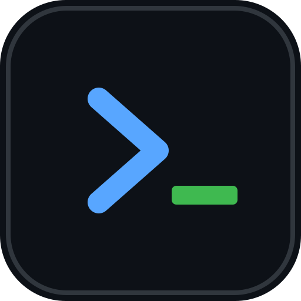

# AlgoDojo · 算法道场

单人使用的算法学习面板：**每天打开，直接告诉你今天学什么、刷哪两题。**



## 现在就能用

**电脑**：双击 `index.html`，用 Chrome / Edge 打开即可。

**手机**（需要 HTTPS 才能"添加到主屏幕"）：

1. 把整个 `algodojo` 文件夹传到一个静态托管（推荐 Vercel，见下）
2. 手机浏览器打开网址
3. iPhone：Safari → 分享 → 添加到主屏幕；Android：Chrome → ⋮ → 安装应用

> 直接双击打开时，数据存在这台设备的浏览器里，不会自动同步到别的设备。

**同一 WiFi 下用手机先试试**：双击 `启动局域网服务.cmd`（需要系统里有 Python），窗口会打印
`http://192.168.x.x:8080`，手机浏览器输入这个地址即可。关掉窗口就停止服务。

## 功能

| 页面 | 能做什么 |
|---|---|
| 今日 | 自动生成「学 1 个知识点 + 刷 2 题」，勾选完成，顺延未完成任务，写一句话复盘 |
| 资料 | 题目/教程/视频/书/文章的增删改查、搜索、标签筛选、关联知识点 |
| 路线 | 4 个阶段 37 个知识点，标记进度，看累计题数和连续天数 |
| 设置 | 每日题量、Codeforces 同步、导出/导入备份、清空数据 |

## 数据存在哪

- 默认：浏览器 `localStorage`（键名 `algodojo.v1`）
- 换设备/清缓存会丢，**请定期在设置里导出 JSON 备份**
- 可以接 Supabase 做多设备同步，见下一节

## 接入云同步（Supabase）

1. 新建 Supabase 项目，打开 **SQL Editor**，执行 [docs/supabase.sql](docs/supabase.sql) 里的语句
2. 打开 **Authentication → Users → Add user**，填邮箱和密码，勾选 **Auto Confirm**
3. 打开 **Settings → API**，复制 **Project URL** 和 **Publishable key**（旧项目叫 anon key）
4. 回到本站 **设置 → 云同步 → 连接 Supabase**，把四个值填进去
5. 第一次连接时如果云端已有数据，会问你保留哪一份

> 本仓库的 `js/config.js` 已预置 Project URL 和 Publishable key，连接时只需再填邮箱和密码。

同步规则：

- 本地改动后 1.5 秒自动上传（整份 JSON 写入 `algodojo_state` 一行）
- 打开页面、切回前台时拉取，比较更新时间，取较新的一份
- 离线时改的东西留在本机，下次联网后上传

> 只填 **Publishable / anon** key。**Secret / service_role key 绝对不要填进网页**。

## 部署到 Vercel（约 5 分钟）

1. 新建 GitHub 仓库，把 `algodojo` 文件夹里的内容推上去
2. vercel.com → Add New Project → 选这个仓库
3. Framework Preset 选 **Other**，Build Command 留空，Output Directory 填 `.`
4. Deploy，拿到 `https://xxx.vercel.app`
5. 手机打开这个网址，按上面的方法添加到主屏幕

## 目录

```
algodojo/
├── index.html            入口
├── css/styles.css        深色代码风样式
├── js/core.js            任务生成、打卡、进度（纯逻辑）
├── js/app.js             页面渲染与交互
├── data/roadmap.js       37 个知识点 + 8 道起步题
├── manifest.json         PWA 配置
├── sw.js                 离线缓存
└── icons/                图标
```

## 规则说明

- 每天首次打开时生成当天任务：1 条学习 + 最多 2 条题（按「每日保底题数」）
- 学习任务按知识点的 `estimatedDays` 拆成「第 x/N 天」，学满即完成，自动进入下一个知识点
- 刷题任务从当前知识点关联的、未完成的题目里取
- 昨天没做完的任务不复制，第二天以「顺延」显示（最多 3 条）
- 同一天重复打开不会重复生成任务

## 已知限制

- 没有云同步，数据在本机
- 洛谷没有公开 API，题目只能手动勾选
- Codeforces 同步是浏览器直连，可能被 CORS 拦截；失败时手动记录即可
- 本地 `file://` 打开时 Service Worker 不生效，PWA 安装需要 HTTPS

## 下一步

1. 建 Supabase 项目，把 URL + anon key 填进来 → 多设备同步
2. 把 37 个知识点补上你的题单
3. 用满两周后再决定要不要加统计图表 / 竞赛日历
